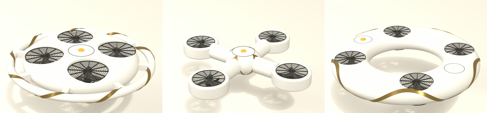

# gavia-hardware

Parte de Gavia, un dron salvavidas autónomo con IA.

Modelos 3D, lista de materiales e instrucciones de armado del dron salvavidas autónomo, que es en
sí mismo el flotador.

> Prototipo experimental en desarrollo. No es un equipo de rescate certificado y no reemplaza a
> un guardavidas.

## Qué hay acá

| Carpeta | Contenido |
|---|---|
| `cad/` | Archivos fuente editables (scripts de Blender, .blend y fichas de física) |
| `stl/` | Piezas listas para imprimir en 3D |
| `bom/` | Lista de materiales |
| `docs/` | Renders, instrucciones de armado y notas de impresión |

## El dron flotador

El dron es el flotador. Vuela hasta la persona, se posa a su lado, corta los motores y la persona se
agarra de él hasta que llega el guardavidas, que siempre va al rescate. El dron gana tiempo.

Es un aro de espuma de celda cerrada de unos 800 mm, crema, con cuatro hélices de 8 pulgadas en
ductos metidos en el propio aro, rejillas de flejes con ranura de 5 mm en las dos caras, una faja
dorada que lo envuelve dos veces y el centro libre para pasar los brazos, como un salvavidas. Es
simétrico arriba y abajo: si se da vuelta, flota y se agarra igual. En el agua un sensor de
conductancia corta los motores con un bloqueo por hardware que solo se resetea en tierra.

Salió de comparar tres conceptos (disco con baranda, cruz de brazos flotantes y aro abierto) con
la misma ficha de física, y de refinar el aro en dos rondas. Los scripts, los .blend y las fichas
están en [`cad/blender/`](cad/blender/README.md).

Las otras piezas propias del proyecto son las dos cápsulas estancas del aro (potencia y señal) y la
carcasa estanca de la botonera del guardavidas.

## Estado

En diseño. Los modelos de Blender son de concepto: todos los números son estimaciones hasta
medirlos en banco y en pileta. Todavía no hay piezas para imprimir.

## Repos del proyecto

- [gavia-vision](https://github.com/LucioFex/gavia-vision): detección y lógica de decisión
- [gavia-firmware](https://github.com/LucioFex/gavia-firmware): botonera ESP32 y configuración de ArduPilot
- [gavia-hardware](https://github.com/LucioFex/gavia-hardware): modelos 3D y lista de materiales (este repo)

## Licencia

[CERN-OHL-P-2.0](LICENSE), una licencia permisiva de hardware abierto. Copyright 2026 Luciano
Esteban y Elías Espinosa.

## Autores

- Luciano Esteban ([@LucioFex](https://github.com/LucioFex))
- Elías Espinosa
