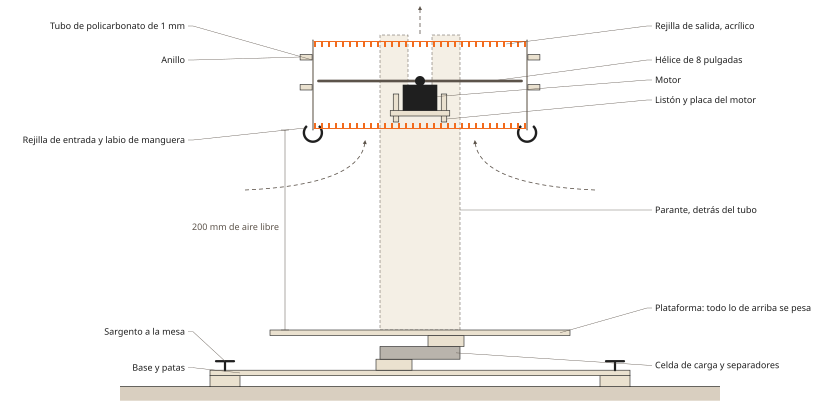

# Banco de empuje de un ducto

Primera etapa del prototipo: un solo motor con su hélice de 8 pulgadas adentro de un ducto como
los del aro, para medir empuje, corriente y cuánto se pierde con las rejillas. La lista de
compras está en `../../bom/lista-de-materiales.md`.



## Qué se mide

Tres configuraciones con el mismo motor y la misma hélice, cada una con un barrido de acelerador
del 30 al 100 %:

| | Configuración | Qué sale |
|---|---|---|
| a | Hélice libre, sin ducto | Empuje base, contra la tabla del fabricante |
| b | Ducto con labio | Ganancia del ducto = b/a |
| c | Ducto con labio y las dos rejillas | Pérdida de las rejillas = c/b |

El labio va de entrada porque en el aro sale gratis: la boca del ducto se redondea en la espuma.
Los resultados reemplazan `kg_por_motor`, `k_ducto` y `k_rejilla` en `../blender/gavia_aro.py`.
Si el empuje/peso que sale da 2 o más, se sigue con ese motor.

## Archivos

| Archivo | Qué es |
|---|---|
| `banco_laser.py` | Genera todas las piezas del banco en 2D a partir de los parámetros del aro |
| `banco_mdf_1.svg`, `banco_mdf_1.dxf` | Plancha 1 de MDF: plataforma, dos parantes y dos listones |
| `banco_mdf_2.svg`, `banco_mdf_2.dxf` | Plancha 2 de MDF: base, dos anillos, dos refuerzos, cuatro patas, cuatro separadores y la placa del motor |
| `banco_armado.svg` | Esquema del banco armado, para entender dónde va cada pieza |
| `rejilla_banco.py` | Genera la rejilla en 2D a partir de los parámetros del aro |
| `rejilla_banco.svg`, `rejilla_banco.dxf` | La rejilla para corte láser en acrílico. Hacen falta dos |

```
python banco_laser.py
python rejilla_banco.py
```

En los archivos de MDF el rojo corta y el azul graba el nombre de cada pieza. El grabado es
opcional.

## Qué decirle al taller de corte láser

Mandar los cuatro archivos (`banco_mdf_1.dxf`, `banco_mdf_2.dxf` y dos veces `rejilla_banco.dxf`)
con un mensaje así:

> Hola, necesito un corte láser con material incluido. Son dos planchas de 600 x 400 mm en MDF
> (fibrofácil) de 5,5 mm, con los archivos banco_mdf_1 y banco_mdf_2, y dos discos en acrílico de
> 6 mm con el archivo rejilla_banco (la misma pieza dos veces). Las medidas están en milímetros.
> El rojo es corte y el azul es grabado, si no pueden grabar ignoren el azul. ¿Cuánto sale y para
> cuándo estaría?

Antes de mandarlo, verificar con la celda y el motor en mano: que los agujeros de la celda caigan
en los colisos y que el motor entre en los agujeros de la placa. Si algo no coincide, se cambia el
número en `banco_laser.py` y se vuelve a generar.

## Medidas

- Rejilla: disco de 212,6 mm en acrílico de 6 mm, flejes de 2 mm, ranura de 5 mm, cinco nervios
  de 2,6 mm y un aro de 4 mm. Entra en el ducto con 0,3 mm de juego por lado. Las ranuras más
  chicas que 15 mm² contra el aro quedan llenas.
- Ducto: tira de policarbonato de 1 mm de 90 por 693 mm, enrollada a 213,2 mm de diámetro
  interior, con 20 mm de solape pegado. Deja 5 mm de holgura en la punta de la hélice, como el aro.
- Labio: manguera de unos 20 mm cortada a lo largo y calzada en el borde de entrada, en cuatro
  tramos entre las ranuras del tubo.
- Motor: Hobbywing XRotor 2812, cuerpo de 34 por 25,5 mm y cuatro M3 en un círculo de 19 mm,
  según la [ficha del fabricante](https://www.hobbywing.com/en/products/xrotor2807). La placa trae
  además colisos en diagonal por si el motor que llega es de 16 x 16 o 19 x 19 mm.
- Celda: barra de 80 x 12,7 x 12,7 mm con dos agujeros M4 o M5 por punta (aprox., a validar). Los
  colisos cubren separaciones de 10 a 20 mm.
- Altura: el ducto queda 200 mm arriba de la plataforma, para que el aire entre libre por abajo.
  La hélice queda unos 4 mm arriba del centro del ducto (aprox., a validar con el motor y la
  hélice reales), a 8 mm de los listones.
- Tara: lo que queda arriba de la celda pesa unos 1,3 kg. Con el empuje del motor, el pico anda en
  4,8 kg (aprox., a validar). La celda de 5 kg queda justa y conviene la de 10 kg.

## Las ranuras del tubo

Los dos listones cruzan el ducto a los costados del motor, así que el tubo lleva cuatro ranuras
abiertas desde el borde de entrada hasta 36,5 mm de alto, de unos 6 mm de ancho. Se cortan con
cúter en la tira, antes de enrollarla, medidas sobre el largo desde la punta que queda adentro del
solape:

| Ranura | Desde | Hasta |
|---|---|---|
| 1 | 141 mm | 147 mm |
| 2 | 189 mm | 196 mm |
| 3 | 477 mm | 484 mm |
| 4 | 526 mm | 532 mm |

Otra forma: enrollar el tubo, presentarlo sobre los listones y marcar con fibra dónde tocan.

## Armado

1. Pegar las patas de a dos debajo de cada punta de la base, con cola vinílica.
2. Atornillar la celda a la base por la punta fija, con dos separadores entre la base y la celda.
   La flecha de la celda apunta hacia abajo.
3. Atornillar la plataforma a la punta libre de la celda, con los otros dos separadores en el medio.
   La plataforma no toca la celda en ningún otro lado.
4. Encastrar los dos parantes y los dos refuerzos en la plataforma y pegarlos.
5. Pasar los listones por las ventanas de los parantes y la placa del motor por las ventanas de
   los listones. Pegar.
6. Atornillar el motor a la placa desde abajo con cuatro M3 de 8 mm. Nunca más largos, porque tocan
   el bobinado.
7. Pegar los dos anillos al tubo, a 40 y 70 mm del borde de entrada (el que tiene las ranuras).
8. Bajar el tubo desde arriba: las ranuras pasan por los listones y los talones de los anillos
   bajan por las ranuras de los parantes hasta apoyar.
9. Calzar la rejilla de entrada adentro del tubo, a 1 mm del borde, y la de salida igual arriba,
   cada una con tres puntos de cinta. Calzar la manguera del labio.
10. Poner la hélice y fijar la base a la mesa con los dos sargentos.

Para la configuración a se saca la hélice, se levanta el tubo con los anillos y se vuelve a poner
la hélice.

El ESC va sobre la plataforma, así los cables del motor no tiran. Los de la batería bajan con una
curva floja, para que no sumen fuerza a la medida.

## Seguridad

Una hélice de 8 pulgadas en 6S corta. El banco va con la base sujeta a una mesa pesada, nadie se
para en el plano de la hélice, el ESP32 corta solo a los 10 s de cada paso, y la batería se carga y
se guarda en bolsa ignífuga.
