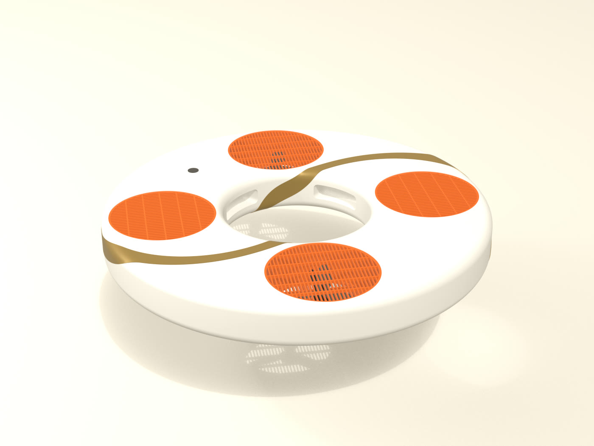

# Modelos de Blender del dron flotador

Scripts paramétricos de Blender 5.2 que arman el dron, lo renderizan y calculan su ficha de
física. Todo se corre sin abrir la interfaz:

```
"C:\Program Files\Blender Foundation\Blender 5.2\blender.exe" -b --python gavia_aro.py
```

Cada script escribe su `.blend` acá y sus renders y su ficha JSON en `renders/<nombre>/`. Los PNG
no se suben al repo (se regeneran), las fichas sí. Los renders finales en JPG están en
`docs/renders/`.



## Archivos

| Archivo | Qué es |
|---|---|
| `gavia_lib.py` | Librería común: geometría, paleta, renders y física |
| `v1_disco.py` | Concepto 1, disco con baranda |
| `v2_cruz.py` | Concepto 2, cruz de brazos flotantes |
| `v3_aro.py` | Concepto 3, aro abierto (el que ganó) |
| `gavia_aro_r1.py`, `gavia_aro_r2.py` | Dos rondas de refinamiento del aro |
| `gavia_aro.py` | Versión final |
| `gavia_botonera.py` | Botonera del guardavidas: caja estanca, dos pulsadores, pantallita y cable USB-C. Piezas en `botonera_piezas.md` |

Los parámetros tienen nombre (`helice_pulg`, `radio_medio`, `alto`, `abertura_rejilla`,
`nervios_rejilla`, `cinta_vueltas` y otros), así cada cambio es reproducible.

## La ficha de física

`gavia_lib.py` calcula, sobre vóxeles de la malla:

- Volumen estanco, masa estimada pieza por pieza y reserva de flotación en agua de mar.
- Curva de carga contra escora con una persona agarrada de un lado: cuántos newtons inclinan el
  dron 10, 20 y 30 grados y desde qué carga se para de canto, en varios puntos de agarre.
- Curva de adrizamiento GZ de 0 a 180 grados.
- Viento con un modelo de placa plana: inclinación para sostenerse en una ráfaga, fuerza sobre la
  cara, arrastre del canto y de los rotores, empuje necesario y momento de cabeceo contra la
  autoridad de los motores.
- Empuje/peso y distancia de la rejilla a la hélice.

Todos los números son estimaciones (aprox., a validar) hasta medirlos en banco y en pileta. Las
masas, el empuje por motor y los coeficientes están en `BASE` y en cada script, con su nota.

## Resultado de la versión final (aprox., a validar)

| Dato | Valor |
|---|---|
| Diámetro y alto | 799 por 90 mm |
| Masa | 3,4 kg |
| Reserva de flotación | 211 N |
| Persona agarrada del canto interior | unos 125 N antes de pararse de canto |
| Empuje/peso | 2,2 |
| Viento sostenible | unos 11 m/s |
| Rejilla | ranura de 5 mm a 38 mm de la hélice |
