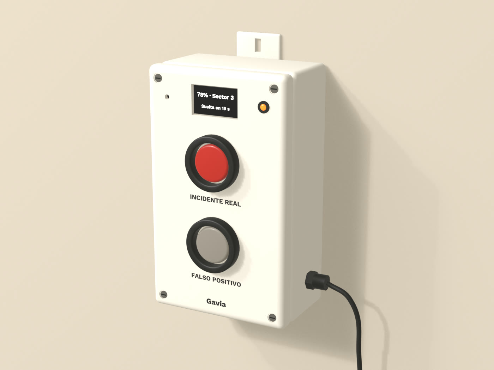

# Botonera del guardavidas: piezas

Lista de piezas del modelo `gavia_botonera.py`. Todas se compran hechas, no hace falta impresora
3D. Las medidas son de piezas comerciales típicas (aprox., a validar con la pieza en mano). Los
precios están a cotizar.

| Pieza | Qué buscar en MercadoLibre | Medida usada en el modelo | Precio |
|---|---|---|---|
| Caja | caja estanca IP65 ABS 200x120x75 | 200 x 120 x 75 mm, tapa con 4 tornillos | a cotizar |
| Botón INCIDENTE REAL | pulsador 30 mm rojo normal abierto | agujero de 30 mm | a cotizar |
| Botón FALSO POSITIVO | pulsador 30 mm gris o blanco normal abierto | agujero de 30 mm | a cotizar |
| Aro protector | guarda protectora para pulsador 30 mm | 44 mm de diámetro, 9 mm de alto | a cotizar |
| Pantalla | display OLED 1.3 pulgadas I2C SH1106 | ventana de 40 x 24 mm | a cotizar |
| Placa | ESP32 USB-C (la misma del banco) | | a cotizar |
| LED de estado | LED 5 mm con portaled metálico | agujero de 8 mm | a cotizar |
| Buzzer | buzzer activo 5 V | agujero de 4 mm | a cotizar |
| Prensacable | prensacable PG7 | agujero de unos 12,5 mm | a cotizar |
| Cable | cable USB-C a USB-A 3 metros | 4 mm de diámetro | a cotizar |
| Ventana | acrílico transparente 2 mm, un retazo | 44 x 28 mm, pegado por dentro | a cotizar |
| Fijación | tornillos para madera de 4 mm | dos, por las orejas | a cotizar |

## Cómo se arma

1. Se marcan y se hacen los agujeros en la tapa: dos de 30 mm para los botones, la ventana de
   40 x 24 mm, uno de 8 mm para el LED y uno de 4 mm para el buzzer. Una mecha copa de 30 mm
   resuelve los botones.
2. Se pega el acrílico por dentro de la ventana con silicona neutra y la pantalla detrás.
3. Se montan los botones con su aro protector y se cablean al ESP32 junto con la pantalla, el LED
   y el buzzer.
4. El cable USB-C entra por el prensacable del costado. Alimenta la botonera y lleva los mensajes a
   la laptop, así que no hay pila adentro.
5. Los rótulos INCIDENTE REAL, FALSO POSITIVO y la palabra Gavia van grabados y rellenos con tinta
   carbón. Si no hay grabado a mano, sirve una etiqueta de vinilo de corte.
6. Se atornilla al poste del puesto por las dos orejas, con el prensacable hacia abajo o al
   costado, para que el agua no entre por ahí.

## Dudas abiertas

- El rojo y el gris de los botones, y si el aro protector va en carbón, se definen con Elías.
- Si la caja comercial viene en gris claro y no en crema, se pinta la tapa o se le pone una placa
  de acrílico crema cortada en láser con los agujeros y los rótulos.
- Los pulsadores de 30 mm con contacto atornillado suelen pedir de 40 a 50 mm de fondo detrás de la
  tapa (aprox., a validar). La caja de 75 mm alcanza.
