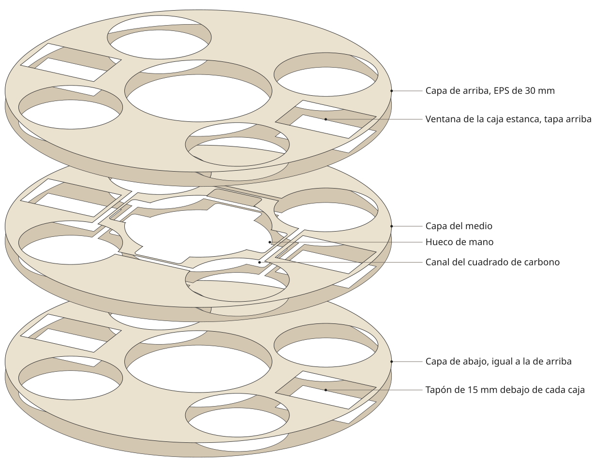

# Cuerpo del aro en capas de EPS

El cuerpo del aro de 800 mm sale de tres capas de telgopor (EPS) de 30 mm pegadas, que suman los
90 mm de alto del modelo. Es también la maqueta de pileta: primero se prueba en el agua con lastre
y después recibe los ductos, las cajas, la electrónica y la piel. Las medidas salen de
`../blender/gavia_aro.py`.



## Archivos

| Archivo | Qué es | Cuántas |
|---|---|---|
| `cuerpo_capas.py` | Genera las capas a partir de los parámetros del aro | |
| `capa_exterior.svg`, `capa_exterior.dxf` | Capa de arriba y de abajo: el anillo, los cuatro agujeros de ducto y las dos ventanas de las cajas | 2 |
| `capa_media.svg`, `capa_media.dxf` | Lo mismo, más los cuatro huecos de mano y el canal del cuadrado de carbono | 1 |
| `tapon_caja.svg`, `tapon_caja.dxf` | Tapón de 15 mm que va debajo de cada caja | 2 |
| `cuerpo_armado.svg` | Esquema de las capas en explosión | |

```
python cuerpo_capas.py
```

La capa del medio sale en dos piezas: el canal del carbono y los ductos la cortan en un anillo de
adentro y uno de afuera. Las dos se pegan a las capas de arriba y de abajo.

## Las cajas

Dos cajas de paso estancas IP65 Kalop (Unika) de 120 x 170 x 75 mm
([MercadoLibre](https://www.mercadolibre.com.ar/x/up/MLAU3893576153), medidas del vendedor, a
validar con la caja en mano), una para la batería y otra para la electrónica. Van enfrentadas
entre los ductos, a 0 y 180 grados, con el lado largo hacia afuera y la tapa enrasada en la cara de
arriba. Así la batería se cambia sacando la tapa, sin cajón por el canto.

Como la caja mide 75 mm y el aro 90, la ventana pasa las tres capas y abajo de cada caja va un
tapón de 15 mm. El tapón sale del recorte de la ventana de la capa de abajo, rebajado a la mitad.

Si se cambia de caja, se cambian los números de `CAJA` en el script y se vuelve a generar. Con una
caja de hasta 60 mm de alto la ventana queda en las capas de arriba y del medio, y la de abajo sale
entera.

## Qué decirle al taller

Sirve un taller de corte de telgopor con hilo caliente o uno de router CNC. Mandar
`capa_exterior.dxf`, `capa_media.dxf` y `tapon_caja.dxf` con un mensaje así:

> Hola, necesito cortar tres capas de un aro en telgopor (EPS) de 30 mm y 30 kg/m3, con material
> incluido si tienen. Son dos veces el archivo capa_exterior y una vez capa_media, más dos tapones
> chicos con el archivo tapon_caja. El aro mide 80 cm de diámetro, las medidas están en milímetros.
> Los agujeros de adentro los pueden encarar por donde les quede mejor. ¿Cuánto sale y para cuándo
> estaría?

Hacen falta tres planchas de 1 x 1 m de 30 mm. Los tapones salen de los recortes.

## Armado

1. Presentar las tres capas en seco, con la del medio entre las dos exteriores, y pasar los cuatro
   tubos de policarbonato por los agujeros de ducto: alinean las capas solos.
2. Pegar de a una capa con adhesivo para telgopor, con los tubos puestos, y dejar secar con peso
   encima.
3. Pegar los tapones en el fondo de las dos ventanas.
4. Lijar el canto de afuera y el de adentro con los radios del modelo (20 mm) y redondear la boca
   de los huecos de mano y de los ductos.

## Medidas

- Aro de 799,2 mm, centro libre de 304,8 mm, agujeros de ducto de 215,2 mm (213,2 mm del ducto más
  el policarbonato de 1 mm) con el centro a 276 mm.
- Huecos de mano de 110 mm de ancho, 30 mm de alto (la capa del medio entera) y 30 mm de
  profundidad, con el fondo redondeado.
- Canal del carbono de 13,5 mm, sobre el cuadrado que une los centros de los cuatro motores.
- Ventanas de 122 x 172 mm, desde 212,4 mm del centro.
- Paredes mínimas: 16 mm entre un ducto y cada canto, 10,4 mm entre una ventana y el canal o el
  canto de afuera, 27,7 mm entre una ventana y un ducto, 33 mm entre un hueco de mano y un ducto,
  y 6 mm entre un hueco de mano y el canal del carbono.
- Espuma: unos 21 L en las tres capas, 0,65 kg con EPS de 30 kg/m3 (aprox., a validar).

## Lo que falta resolver

- La pared de 6 mm entre cada hueco de mano y el canal del carbono es fina. Si se rompe al cortar,
  se rellena con adhesivo o se achica la profundidad del hueco a 25 mm.
- El motor mide 25,5 mm de alto. Con la hélice centrada en el ducto, su base queda a unos 30 mm
  abajo del centro (aprox., a validar), y un tubo de carbono a media altura no puede pasar por
  debajo. La salida más simple es la del banco: el tubo llega hasta la pared del ducto y el motor va
  en un puente de dos listones, como en `../banco/`.
